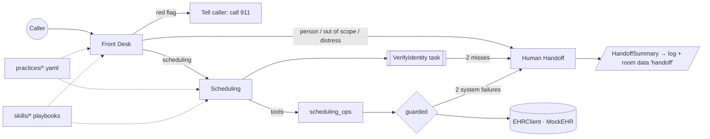

# medical-secretary

A voice AI front desk for physician practices, built on [LiveKit Agents](https://docs.livekit.io/agents/) (Python). Status: pre-release (`0.x`), see the [CHANGELOG](CHANGELOG.md).

## What it is

Callers reach a virtual front desk that books, reschedules and cancels appointments against an EHR, answers basic practice questions, and hands everything else to a human. It is built "hero in the loop": the agent handles the routine calls and recognizes its limits. Red-flag symptoms get a "call 911" instruction, out-of-scope requests and repeated failures go to staff with a structured summary, and the agent never gives medical advice. Each practice is a YAML template (hours, providers, visit types, escalation routes), so a new practice is a config file, not a code change. The EHR is a FHIR-shaped mock with deterministic data and fault injection, so behavior is testable and demos are safe. The full design is in the [v0 spec](docs/superpowers/specs/2026-10-21-v0-livekit-voice-agent-design.md).

## Quick start

```bash
brew install livekit-cli
lk cloud auth
lk app env -w            # writes .env.local with LiveKit Cloud credentials
make install
uv run -m livekit.agents download-files   # turn detector + noise cancellation models
make console-text        # talk to the agent by typing
make console             # or by voice
```

Pick a practice with `PRACTICE_ID=dermatology-demo make console-text` (default: `pediatrics-burlington`; see `.env.example`).

## Demo script

Run `make console` (voice) or `make console-text` with the default pediatrics practice. The mock EHR is seeded with these patients (name, date of birth): Emma Johnson 2018-03-05, Liam Garcia 2015-11-20, Olivia Smith 1984-07-14. Wording does not need to match exactly; this is the shape of each call.

1. **Book a sick visit.** Say: "Hi, my daughter has a cough and I'd like to bring her in this week." Front Desk routes to Scheduling, which asks you to verify identity: "Emma Johnson, March 5th, 2018." It offers real open slots, and after you pick one and say yes to the read-back, it books and confirms. The booking only happens after an explicit confirmation.
2. **Stale provider.** Ask for "Dr. Jones". Expected: the agent says that provider is not at the practice and offers Dr. Patel or Dr. Nguyen instead. A provider that exists in the practice file but has gone stale in the EHR gets the same treatment (it is reported unavailable and alternatives are offered). The stale-in-EHR case needs fault injection, so it is demonstrated by the evals (`Faults(stale_practitioner_ids=...)`), not the live console.
3. **EHR outage then staff.** Expected: after two system failures the agent stops retrying, apologizes and transfers to staff with a summary. The live console has no switch for faults, so this is demonstrated by the evals (`Faults(fail_ops=...)`) and unit tests of the resilience wrapper. You can see the same escalation live by failing identity verification twice (give a wrong name or birth date two times): the agent hands off to staff.
4. **Refill request, honest decline.** Say: "I need a refill on my son's prescription." Expected: the agent says it can't help with that over the phone yet and offers to connect you to staff; it does not pretend to process the refill. Say yes and it hands off.
5. **Emergency.** Say: "My baby is having trouble breathing." Expected: immediately, "This could be an emergency. Please hang up and call 911 right now." No booking, no transfer, no questions first.

## Architecture



- `src/medical_secretary/agents/`: Front Desk, Scheduling, Human Handoff agents. `tasks/verify_identity.py` is a LiveKit `AgentTask` (name + date of birth, two attempts).
- `scheduling_ops.py` holds the business rules (confirmation and ownership guards) without any LLM, so they are unit tested directly. `tools/resilience.py` wraps EHR calls with timeouts and failure counting.
- `ehr/`: an `EHRClient` interface and `MockEHR` with fault injection (latency, timeouts, outages, stale providers, no slots).
- `server.py`: the `AgentServer` entrypoint with LiveKit Inference STT/LLM/TTS, turn detector and noise cancellation. The practice comes from `PRACTICE_ID` or from job metadata `{"practice_id": "..."}`.
- Decisions are recorded as ADRs in [`docs/adr/`](docs/adr/). Domain terms are in [`CONTEXT.md`](CONTEXT.md).

## Practices as templates

A practice is one file in `practices/`: name, timezone, hours, greeting and tone, providers, visit types, booking window, escalation routes, and which runtime skills are enabled. It is validated at load time against a schema. Two ship today: `pediatrics-burlington` (Lake Champlain Pediatrics) and `dermatology-demo` (Green Mountain Dermatology). To add one, copy a file, edit it and run the tests; the `add-practice` dev skill walks through it.

## Agent Skills

The repo uses the [Agent Skills](https://agentskills.io) format in two places, kept separate on purpose:

- **Runtime skills** (`skills/`): `escalation-rules` and `scheduling-policy`, playbooks the voice agent itself follows. A practice enables them in its YAML, and they are rendered into the agent's instructions when the agent is constructed at handoff, not loaded mid-turn, so they add no turn latency ([ADR 0003](docs/adr/0003-runtime-skills-at-handoff.md)). Each has its own evals.
- **Dev skills** (`.claude/skills/`): instructions for coding agents working on this repo: `livekit-dev`, `run-evals`, `release`, `add-practice`, plus the official LiveKit skills installed with `lk skills install`.

## Testing

| Tier | What | Run |
| --- | --- | --- |
| Unit | Deterministic, no LLM or network (EHR, ops rules, resilience, config, skills loader, release script) | `make test` (part of `make check`) |
| LLM evals | Behavior of each agent and runtime skill using LiveKit's eval harness; needs credentials and costs money | `make evals` |
| Simulations | Simulated callers from `scenarios.yaml` (anxious parent, rambler, emergency, bad connection, interrupter) on LiveKit Cloud | `make simulate` |

`make check` runs ruff, pyright and the unit tests, and is what CI runs on pull requests and pushes to main. Evals and simulations run through the Evals GitHub workflow, manually or when the `run-evals` label is added to a PR.

## Development

- `make console-text` / `make console` to talk to the agent; `make dev` runs `lk agent dev` for the LiveKit Cloud Agent Console.
- Turn by turn debugging with tool calls visible: `lk agent debugger start`, `lk agent debugger say "..." --logs`, `lk agent debugger restart` after each code edit (a running session keeps the old code), `lk agent debugger stop`.
- `lk docs` searches current LiveKit docs; use it before guessing at an API.
- Every observed failure becomes an eval or scenario before it is fixed. Behavior changes start with the eval, then the prompt or tool.
- Conventions (Conventional Commits, changelog, ADRs) are in [`AGENTS.md`](AGENTS.md).

## Known limitations (v0)

- **Transfer to staff is simulated.** The handoff publishes a structured summary (logged, and sent as a room data message on topic `handoff`); no call is actually transferred. In text simulation the Human Handoff agent keeps asking the caller to hold.
- **Mock EHR only.** All data is synthetic; no real PHI, no real EHR integration.
- **English only.**
- **Refills, billing and test results are out of scope** and are declined and handed to staff.
- **Handoff summaries contain PHI-shaped data.** The summary includes the caller's name and is broadcast to all room participants and logged at INFO. Acceptable with synthetic data; it must be restricted before any real PHI.
- **Evals coverage.** Full-conversation JudgeGroup evals are not yet added (turn-level judges plus simulations cover quality).
- **Practice selection** reads job metadata (or `PRACTICE_ID`), not room metadata.
- Fault scenarios (stale provider, EHR outage) are exercised by the evals, not switchable from the live console.

## Roadmap

- `0.2.0`: Refill Request agent.
- `0.3.0`: SIP inbound and real warm transfer.
- `0.4.0`: WhatsApp chat channel sharing agents and skills.
- Later: FHIR sandbox integration, call analytics (SQL over transcripts), MCP server exposing EHR tools.

## Versioning

[Semantic Versioning](https://semver.org). Every behavior change adds a line to `[Unreleased]` in the [CHANGELOG](CHANGELOG.md) ([Keep a Changelog](https://keepachangelog.com) format). Releases are cut only through the `release` skill (`.claude/skills/release`), which bumps `pyproject.toml`, rolls the changelog and tags.
